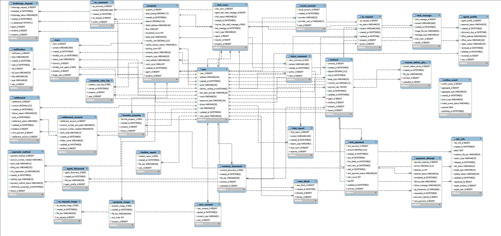
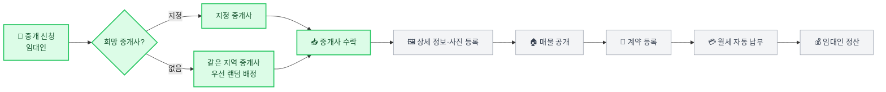

<div align="center">


# 보금

**집을 구할 때부터 나갈 때까지, 보증금과 월세를 기록으로 관리하는 부동산 서비스**

`보증금` + `보금자리` — 보증금과 사는 집을 함께 지킨다는 뜻이에요.

</div>

---

## ✨ 프로젝트 소개

#### 프로젝트 배경
- 전·월세 계약은 보증금과 월세가 오래, 큰 금액으로 오가지만 납부·반환 내역이 개인 기록에만 남아 다툼이 생기기 쉽다.
- 임차인은 계약 전에 임대인·매물의 위험 신호(보증금 미반환 이력, 근저당 등)를 확인하기 어렵다.
- 임대인과 중개사는 매물 등록, 계약, 월세 수납, 하자·AS 처리를 각각 다른 곳에서 관리한다.

#### 프로젝트 목표
- **임대인·임차인** : 매물을 쉽게 찾고, 계약 후 월세 자동 납부·수납·정산과 입주·퇴실 기록을 한곳에서 관리한다.
- **중개사** : 임대인의 중개 신청을 받아 매물 상세 정보를 올리고 계약 정보를 등록한다.
- **관리자** : 중개사 가입을 검증하고, 위험 매물·위험 사용자와 신고된 대화를 관리한다.

#### 핵심 가치

| 가치 | 설명 |
|:---:|---|
| 🔍 **쉽게 찾는다** | 조건으로 매물을 찾고, 관심 매물로 저장하고, 채팅으로 중개사와 바로 연락한다 |
| 🛡️ **안전하게 확인한다** | 확인된 위험 신호를 매물 상세와 채팅방에 뜻과 함께 안내한다 |
| 🗂️ **편리하게 관리한다** | 계약을 등록하면 월세 납부, 기한 알림, 입주 기록, 정산까지 이어진다 |

#### 개발 기간
`2026.09.28 ~ 2026.11.20`

<br>

---

<div align="center">

### 🌐 보금 바로가기


**🔐 테스트 계정** — 추가 예정

</div>

---

## 🤼‍♂️ 팀원 소개

| 기영서 | 김동환 | 노승찬 |
| :---: | :---: | :---: |
|  |  |  |
| [@BUSWINDOW](https://github.com/BUSWINDOW) | [@0xdhkim](https://github.com/0xdhkim) | [@seungchan-0629](https://github.com/seungchan-0629) |
| 회원·인증 (일반·소셜 로그인, 회원가입·동의)<br>마이페이지 · 결제 수단·정산 계좌<br>월세 자동 납부·수납 현황 · 월세 정산<br>위험 정보 안내 | 관리자 중개사 조회·가입 검증<br>월세 납부·연체 내역 관리<br>위험 사용자 관리<br>AS 요청 · 입주 하자 사진 · 클레임 | 매물·중개 (신청·수락·목록·상세·계약)<br>추천·관심 매물 · 중개 이력<br>채팅 · 알림 · 위험 매물 관리<br>AI 챗봇 |

<br>

---

## 📌 기술 스택

### Frontend
<div>


</div>

### Backend
<div>


</div>

### Data
<div>


</div>

### Tools
<div>


</div>

---

## 🏗️ 시스템 아키텍처

```mermaid
flowchart LR
    User([👤 사용자<br/>임대·임차인 / 중개사 / 관리자])

    subgraph FrontLayer [" 🎨 Frontend "]
        direction TB
        React[⚛️ React 19 + Vite<br/>React Router · TanStack Query · Zustand]
        Proxy[🔀 Vite Proxy<br/>/api · /property/]
    end

    subgraph BackendLayer [" ⚙️ Backend · Spring Boot 4 "]
        direction TB
        Security[🔐 Spring Security<br/>JwtFilter · CSRF · 역할 권한]
        Controller[Controller]
        Service[Service<br/>@Transactional]
        Repository[Spring Data JPA]
        Security --> Controller --> Service --> Repository
    end

    subgraph DataLayer [" 💾 Data "]
        DB[(MySQL 8<br/>Docker)]
    end

    subgraph External [" 🔗 외부 연동 (예정) "]
        direction TB
        Postcode[📍 우편번호 검색]
        Payment[💳 PG · CMS<br/>월세 자동 납부]
        AI[🤖 AI 챗봇]
    end

    User ==>|HTTPS| React
    React --> Proxy
    Proxy ==>|REST · Bearer JWT| Security
    Repository --> DB
    React -.-> Postcode
    Service -.-> Payment
    Service -.-> AI

    classDef front fill:#dbeafe,stroke:#3b82f6,stroke-width:2px,color:#1e3a8a
    classDef backend fill:#ede9fe,stroke:#8b5cf6,stroke-width:2px,color:#4c1d95
    classDef data fill:#dcfce7,stroke:#22c55e,stroke-width:2px,color:#14532d
    classDef external fill:#f3f4f6,stroke:#9ca3af,stroke-width:1px,stroke-dasharray:4 3,color:#374151

    class React,Proxy front
    class Security,Controller,Service,Repository backend
    class DB data
    class Postcode,Payment,AI external
```

- 화면은 Access 토큰을 메모리에 두고 `Authorization: Bearer` 헤더로 보내요. 만료되면 Refresh 토큰으로 자동 갱신해요.
- 백엔드는 기능별 패키지(`domain/{user, agent, property, contract, rent, settlement, chat, notification, risk, ...}`)로 나눠요.

---

## 🗂️ ERD

<details>
<summary><b>보금 ERD 보기</b></summary>
<br>



</details>

---

## ✨ 주요 기능

### 🏠 임대인 · 임차인

| 기능 | 설명 | 요구사항 |
|---|---|:---:|
| **매물 중개 신청** | 임대 형식·가격·주소를 입력해 신청. 희망 중개사가 없으면 **같은 지역 중개사를 우선 배정** | PROPERTY_002 |
| **매물 검색·상세** | 매물 종류·가격·면적·지역·지하철역 등 조건 검색, 상세 정보와 사진 | PROPERTY_003~005 |
| **관심 매물 · 추천** | 관심 매물 저장, 조회 지역 기반 인기 매물과 유사 매물 추천 | FAVORITE_001~003, RECOMMEND_001~002 |
| **채팅** | 매물별 1:1 실시간 채팅, 이미지 전송, 읽음 표시, 차단 | CHAT_002~010 |
| **월세 자동 납부** | PG·CMS로 결제 수단 등록, 납부일 자동 결제와 실패 시 재시도 | USER_013~014, RENT_004~007 |
| **수납 현황 · 정산** | 매물별 월세 수납 현황, 결제 성공 시 임대인에게 즉시 지급 | USER_015, RENT_003, SETTLE_001~002 |
| **입주 · AS · 클레임** | 입주 하자 사진 기록, 시설 AS 요청·응답, 매물별 클레임 접수 | MOVEIN_001~002, AS_001~003, CLAIM_001 |
| **위험 정보 안내** | 매물 상세·채팅방에서 확인된 위험 신호를 안내 (사유 상세는 비공개) | RISK_006~007 |

### 🏢 중개사

| 기능 | 설명 | 요구사항 |
|---|---|:---:|
| **가입 · 서류 제출** | 중개사무소 정보로 가입, 공인중개사 서류 제출 후 관리자 승인 | USER_016~021 |
| **중개 신청 목록 · 수락** | '새 신청' / '수락한 신청' 탭, 페이지 단위 조회, 수락하면 매물을 맡음 | PROPERTY_012, PROPERTY_008 |
| **매물 상세 정보 등록** | 수락한 매물의 상세 정보와 건물·방 사진 업로드 | PROPERTY_009~010 |
| **계약 정보 등록 · 중개 이력** | 계약 당사자·금액·보수와 계약서 이미지 등록, 내가 중개한 계약 조회 | PROPERTY_011, AGENT_003 |

### ️️🛠️ 관리자

| 기능 | 설명 | 요구사항 |
|---|---|:---:|
| **중개사 관리** | 중개사 정보 조회(페이징·검색), 가입 서류 검증과 최종 승인 | AGENT_001~002 |
| **매물 · 위험 매물 관리** | 등록 매물 열람, 위험 매물 조회와 숨김 처리 | PROPERTY_001, RISK_004~005 |
| **위험 사용자 관리** | 보증금 미지급·월세 연체 등으로 위험 사용자 등록·조회·수정 | RISK_001~003 |
| **월세 납부 · 연체 내역** | 임차인별 납부 내역, 결제 실패·연체 목록 | RENT_001~002 |
| **신고 대화 열람** | 신고된 건에 한해 1:1 대화 이력 열람 | CHAT_001 |

### 🌐 공통

| 기능 | 설명 | 요구사항 |
|---|---|:---:|
| **인증 · 역할 권한** | JWT 로그인, 소셜 로그인(네이버·카카오·구글), 역할(USER / AGENT / ADMIN)별 접근 제어 | USER_001~012 |
| **알림** | 월세 납부·미입금, 중개 신청, 채팅, AS, 위험 정보 등 앱·웹 내 알림 | NOTIFY_001~025 |
| **AI 챗봇** | 자연어 매물 검색, 월세·AS 조회, 관리자 위험 현황·PDF 보고서 | CHATBOT_001~010 |

---

## 🧭 핵심 흐름 — 중개 신청부터 정산까지



> 🟩 구현 완료 · ⬜ 개발 중

---

## 🖼️ 주요 화면

> 추가 예정

---

## 🚀 로컬 실행

<details>
<summary><b>실행 방법 보기</b></summary>
<br>

#### 1. DB (Docker MySQL, 포트 3307)
`backend/.env`를 만들고 아래 키를 채워요. 값은 팀 내에서 공유해요.

```properties
DB_URL=
DB_USERNAME=
DB_PASSWORD=
```

```bash
cd backend
docker compose up -d
```

#### 2. Backend (http://localhost:8080)
```bash
cd backend
./gradlew bootRun     # 실행 (기본 프로필 dev)
./gradlew test        # 테스트 (H2 인메모리 DB)
```
- 더미 데이터는 `backend/src/main/resources/data.sql`이에요. DB에 직접 실행해서 넣어요.

#### 3. Frontend (http://localhost:5173)
```bash
cd frontend
npm install
npm run dev           # 실행
npm run lint          # 린트 (oxlint)
npm run build         # 빌드
```
- 개발 중에는 Vite가 `/api`, `/property/` 요청을 `http://localhost:8080`으로 프록시해요.

#### 폴더 구조
```
bogeum/
├─ backend/    Spring Boot 4.1.1 · Java 17 · Gradle
│  └─ src/main/java/com/bogeum/
│     ├─ domain/{기능}/   Controller · Service · Repository · model(엔티티·DTO)
│     ├─ common/          enums · exception · model
│     ├─ config/          Security · JWT 필터 · 전역 설정
│     └─ utils/
├─ frontend/   React 19 · Vite
│  └─ src/  api · components · pages · hooks · stores · router · utils
└─ docs/       ERD 등 산출물
```

</details>

---

## 📚 협업 규칙

<details>
<summary><b>Git · 이슈 · PR 규칙 보기</b></summary>
<br>

#### 작업 흐름
```
이슈 생성 → 브랜치 생성 (dev 기준) → 기능 구현 → 커밋 → PR (feature → dev, 본문에 Closes #이슈번호) → 리뷰 → 머지
```

#### 브랜치
| 브랜치 | 용도 |
|---|---|
| `main` | 배포용 안정 버전 |
| `dev` | 다음 버전 개발. 기능 브랜치가 모이는 곳 |
| `feat/{영역}/{기능}` | 기능 개발 (예: `feat/backend/property_request`) |
| `fix/…` · `chore/…` | 버그 수정 · 문서·설정 작업 |

#### 커밋 말머리
| 말머리 | 의미 |
|---|---|
| `[Feat]` | 새로운 기능 |
| `[Fix]` | 버그 수정 |
| `[Docs]` | 문서 수정 |
| `[Test]` | 테스트 코드 |
| `[Refactor]` | 리팩토링, 파일·폴더 이동 |
| `[Design]` | CSS·레이아웃 |
| `[Chore]` | 빌드·패키지·설정 등 코드 외 작업 |

예) `[Feat] - 매물 중개 신청 기능 구현 - PropertyController: 중개 신청 API 추가`

#### 이슈 · PR
- 모든 작업은 이슈를 만든 뒤 시작해요. 이슈 제목은 `[Feat] {요구사항 ID} {기능명} (BE/FE)` 형식이에요.
- PR은 이슈 하나 단위로 올리고, 템플릿(📋 Summary / 📂 변경 파일 / ✨ 주요 변경 사항)을 따라요.

#### 백엔드 코드 규칙
- 패키지는 기능별(`domain/{기능}`)로 나누고, 생성자 주입을 써요.
- Service는 인터페이스 없이 클래스로 만들고, 메서드는 CRUD 순서로 둬요.
- 엔티티에 `@Setter`를 쓰지 않고, 의도가 드러나는 메서드로 값을 바꿔요.
- 예외는 enum + 정적 팩토리 메서드로 만들고, `@RestControllerAdvice`에서 공통 에러 응답(`ErrorResponse`)으로 바꿔요.

</details>
